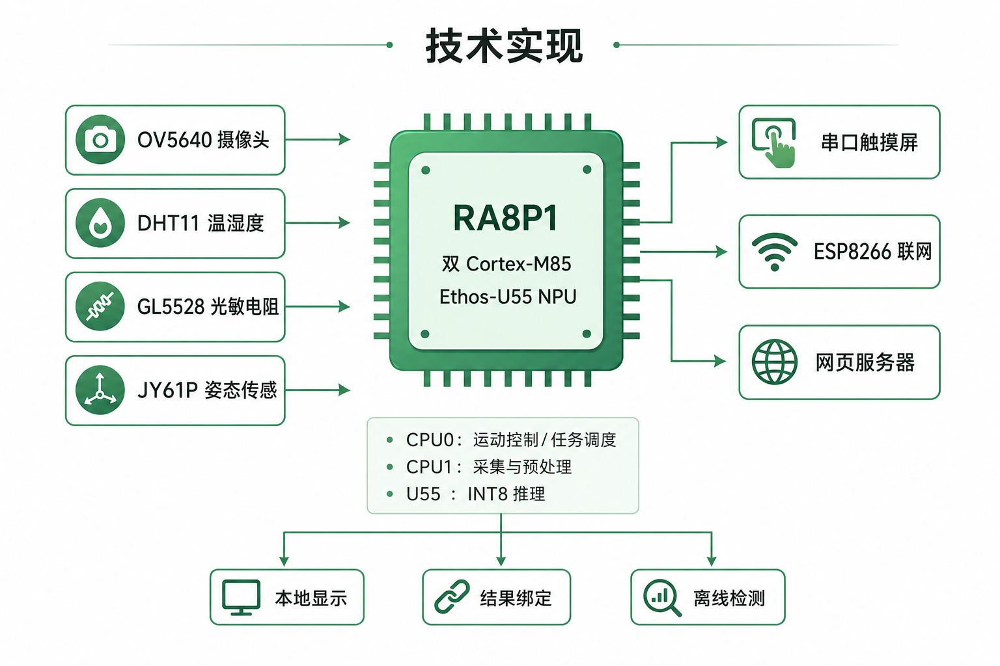
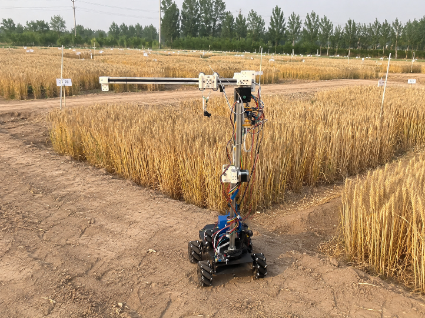
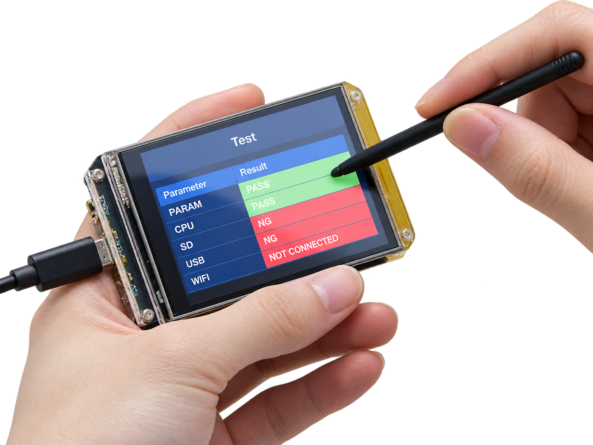

# 基于 RA8P1 的小麦麦穗智能计数与环境监测系统

**RA8P1 Wheat Inspection | Embedded Vision · Edge AI · YOLOX · Environmental Monitoring**

> 2026 年全国大学生电子设计竞赛信息科技前沿专题赛（瑞萨杯）决赛团队项目。
> 采用 [Rockchip 仓库](https://github.com/Bangyu-Hong/rockchip) 的展示结构整理。

## 🎬 项目展示 | Demo & Materials

- [📄 完整技术报告](./materials/ra8p1/技术报告.pdf)
- [📋 作品简介](./materials/ra8p1/作品简介.pdf)
- [📊 项目答辩 PPT](./materials/ra8p1/项目答辩.pptx)
- [💻 项目源码与模块导航](./src/ra8p1/README.md)

本地材料包含报告、演示文稿、设备图片和工程源码，未发现独立演示视频。具体功能完成情况以对应版本的工程与实测记录为准。

## 1. 项目概览 | Overview

本项目面向小麦育种样本与标准样方调查，围绕麦穗计数、图像复核及环境信息记录，构建基于 **RA8P1 + OV5640 + Ethos-U55 + ESP8266** 的嵌入式视觉系统。

项目涉及摄像头采集、YOLOX 分块推理、坐标恢复与全局去重、本地显示、温湿度与光照采集、局域网交互和 SD 存储。

| 平台 / 模块 | 主要职责 |
|---|---|
| **RA8P1 / Cortex-M85** | 采集、预处理、服务调度、推理后处理与任务接口 |
| **Ethos-U55** | 经 RUHMI 工具链部署的端侧模型推理 |
| **OV5640** | 小麦图像采集 |
| **ST7796S** | 实时画面与检测结果显示 |
| **DHT11 / 光照传感器** | 温湿度与相对光照采集 |
| **ESP8266** | Wi-Fi 接入及局域网 HTTP / WebSocket 数据交互 |
| **TJC 串口屏 / SD** | 人机交互资料、参数输入与数据记录 |

**版本说明：** 保存的产品源码来自 2026-08-18 的 `camera` 工程快照，该快照以 M85 单核为基线，M33 底盘、滑轨和整田自动巡检在当时的交付记录中仍为规划或待集成。后续答辩 PPT 展示了整机与田间照片，两类材料对应不同时间点。提交报告、产品快照和后续展示材料分别说明，详见 [版本与验证说明](./docs/VERSION_STATUS.md)。

## 2. 系统架构与核心代码 | Architecture & Code

```text
OV5640 → RA8P1 / Cortex-M85
              ├─ 图像采集、分块与预处理
              ├─ Ethos-U55：YOLOX 推理
              ├─ 坐标恢复、全局 NMS 与计数
              ├─ ST7796S：画面和结果显示
              ├─ DHT11 / ADC：环境采集
              ├─ SD：记录与导出
              └─ ESP8266 → HTTP / WebSocket → 局域网网页

HMI、M33 底盘与滑轨：保留独立资源、接口和交接方案
```



**系统组成方案，来自答辩 PPT 第 10 页。** 该图展示答辩中的系统设计；保存源码的实现状态按对应快照记录说明。

### 核心模块

| 模块 | 代码中的主要实现 | 源码 |
|---|---|---|
| 产品主工程 | 初始化、外设服务与协作式调度 | [camera](./src/ra8p1/camera/) / [app.c](./src/ra8p1/camera/src/app.c) |
| 摄像头采集 | OV5640、CEU、帧缓冲管理 | [camera_capture.c](./src/ra8p1/camera/src/camera_capture.c) |
| 模型推理 | RUHMI / Ethos-U55 后端与模型存储 | [wheat_ai_backend.c](./src/ra8p1/camera/src/wheat_ai_backend.c) |
| 图像预处理 | 图像输入与分块预处理 | [wheat_preprocess.c](./src/ra8p1/camera/src/wheat_preprocess.c) |
| 检测后处理 | YOLOX 解码、检测框恢复与筛选 | [wheat_yolox_decode.c](./src/ra8p1/camera/src/wheat_yolox_decode.c) / [wheat_postprocess.c](./src/ra8p1/camera/src/wheat_postprocess.c) |
| 模型部署工具 | 主机侧模型转换、量化与数值检查 | [wheat_deployment](./src/ra8p1/camera/tools/wheat_deployment/) |
| 环境采集 | DHT11、光照与环境服务 | [environment_service.c](./src/ra8p1/camera/src/environment_service.c) |
| 网页与联网 | ESP AT、HTTP / WebSocket、网页资产 | [web_ui_page.inc](./src/ra8p1/camera/src/web_ui_page.inc) |
| 数据存储 | SD、记录队列与恢复服务 | [storage_service.c](./src/ra8p1/camera/src/storage_service.c) |
| 串口屏 | HMI 工程、字体和素材 | [hmi](./src/ra8p1/hmi/) |
| 报告核心代码 | C99 附录程序与板级适配接口 | [report_core](./src/ra8p1/report_core/) |

**已有测试入口：** [主机测试目录](./src/ra8p1/camera/tests/) · [模型部署测试脚本](./src/ra8p1/camera/tests/run_wheat_host_tests.ps1)。历史测试记录与本次文件整理检查分开说明。

### 视觉模型


**YOLOX-Tiny 网络与检测头结构，来自答辩 PPT 第 11 页。** 项目围绕密集小目标采用重叠分块、坐标回映射与全局去重的处理路线，具体部署契约以保存工程为准。

### 目录结构

```text
.
├─ README.md                 项目展示与导航
├─ src/ra8p1/
│  ├─ camera/                产品主工程快照
│  ├─ hmi/                   串口屏、字体与素材
│  ├─ report_core/           报告附录核心代码
│  └─ README.md              模块与工程说明
├─ images/ra8p1/             设备与硬件展示图
├─ materials/ra8p1/          最终报告、简介、答辩与本地固件
├─ docs/                     运行、版本、交接资料与整理映射
├─ tools/                    整理与完整性核对工具
└─ archive/                  原始材料及此前整理副本，本地保留
```

## 3. 个人贡献 | My Contributions

本项目由团队合作完成。**本人负责模型优化与底盘搭建。**

- **模型优化：** 负责小麦检测模型优化。模型部署与验证工具作为项目技术资料保留；优化前后的模型版本、精度和端侧耗时对比待补充。
- **底盘搭建：** 负责移动底盘的搭建。运动控制固件的具体作者分工以团队记录为准；当前交付快照中的底盘与整田自动巡检仍有集成工作。

第三方框架、模型工具链及团队其他成员开发的模块不作为本人独立原创成果。

## 4. 项目实验与结果 | Experiments & Results

### 4.1 整机实物 | Robot Prototype


**图 1. 小麦巡检系统整机，来自答辩 PPT 第 9 页。** 展示麦轮底盘、立式支架与横向采样单元。

### 4.2 田间场景 | Field Scene



**图 2. 小麦田间场景，来自答辩 PPT 第 6 页。** 作为设备与使用环境的展示，照片不单独证明完整自主巡检已通过验收。

### 4.3 底盘与核心控制板 | Chassis & Controller

| 麦克纳姆轮底盘 | RA8P1 核心控制板 |
|---|---|
|  |  |

**图 3. 底盘与控制板，均来自答辩 PPT 第 9 页。**

### 4.4 人机交互 | Human-Machine Interface



**图 4. 串口屏展示，来自答辩 PPT 第 9 页。** 页面工程和板端协议联调分别记录，详见 [最终通信协议](./docs/ra8p1/hmi/WHEAT_串口屏最终通信协议_20260819.md)。

### 4.5 验证状态 | Verification Status

| 内容 | 当前展示材料与边界 |
|---|---|
| 图像采集与显示 | 产品源码、实物照片、历史交付记录；本次未重新实测 |
| YOLOX / Ethos-U55 推理 | 部署代码与历史链路记录；可运行与田间精度合格分别判断 |
| 模型优化效果 | 待补充相同数据与硬件条件下的前后对比 |
| 环境、局域网与 SD | 源码和历史功能状态表；压力与故障恢复测试以原记录为准 |
| 串口屏、底盘与滑轨 | HMI、接口和交接资料；集成状态按对应版本说明 |
| 整田自主巡检 | 2026-08-18 快照中未完成，不作为完整闭环成果展示 |

详细历史状态见 [当前进度与验收状态](./docs/ra8p1/handover/02_当前进度与验收状态.md)。

## 5. 环境与运行 | Setup & Usage

- [环境与运行指引](./docs/SETUP.md)：工程入口、开发环境、HMI 与报告核心代码的适配前提。
- [源码构建烧录与恢复指南](./docs/ra8p1/handover/07_源码构建烧录与恢复指南.md)：原始交付说明。
- [版本与验证说明](./docs/VERSION_STATUS.md)：实际快照、提交报告和后续协议的关系。

整理保留工程内部目录和业务代码。构建缓存、历史备份与原始压缩包留在本地归档。历史固件按其原始说明保留在本地，含潜在设备配置的文件默认不纳入 Git。

## 6. 第三方依赖与致谢 | Third-Party Software

工程涉及 Renesas FSP / CMSIS / RUHMI、Ethos-U、YOLOX、FatFs 和相应厂商组件。第三方代码与自动生成代码保留原有声明，不作为个人独立原创成果。

感谢谭溶阳、常俊豪、洪邦羽及项目团队在模型、硬件、软件和联调中的合作。未新增统一开源许可证，各组件使用范围以原声明为准。

---

*整理日期：2026-11-15。展示配图全部来自答辩 PPT，未使用技术报告配图，详见 [图片来源](./docs/IMAGE_SOURCES.md)。文件来源见 [整理映射](./docs/文件整理映射.csv)，检查结果见 [verification_result.json](./docs/verification_result.json)。*
