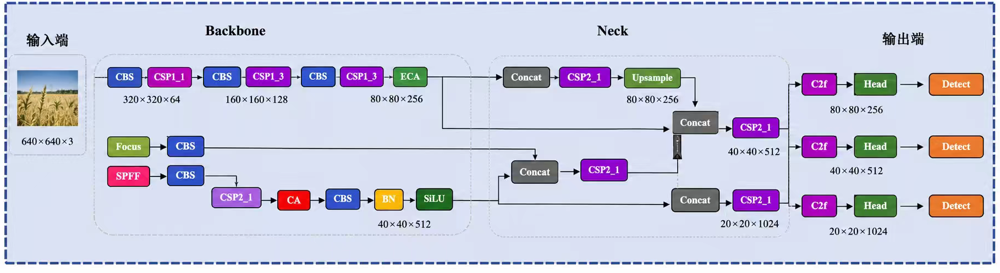
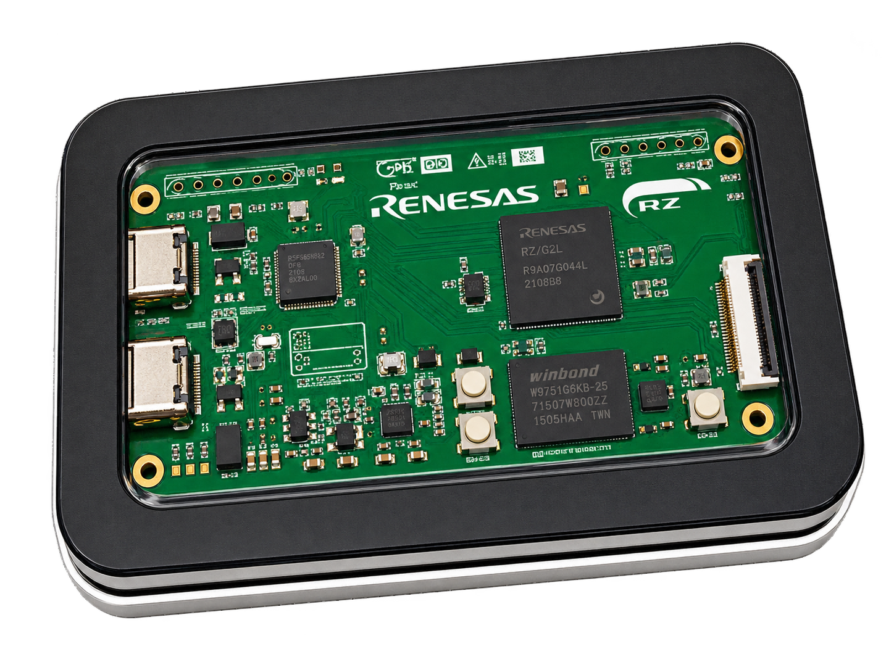

# 基于 RA8P1 的小麦麦穗智能计数与环境监测系统

**RA8P1 Wheat Inspection | Embedded Vision · Edge AI · YOLOX · Environmental Monitoring**

> 2026 年全国大学生电子设计竞赛信息科技前沿专题赛（瑞萨杯）决赛团队项目。

> **报告与实物差异说明：** 技术报告与最终搭建的实物存在差异。报告作为设计方案和参赛资料保留，不作为最终实物的完整实现说明，也不代表其中全部功能均已在实物中实现或验证。实物外观与搭建形式以答辩 PPT 中的实物照片为参考，具体功能和性能以对应版本的实机演示及测试记录为准。

## 🎬 项目展示 | Demo & Materials

- [📄 技术报告（与最终实物存在差异）](./技术文档.pdf)
- [📋 作品简介](./作品简介.pdf)
- [📊 项目答辩 PPT](./项目答辩.pptx)
- [💻 项目源码与模块导航](./src/README.md)

本地材料包含报告、演示文稿、设备图片和工程源码。具体功能完成情况以对应版本的工程与实测记录为准。

## 1. 项目概览 | Overview

本项目面向小麦育种样本与标准样方调查，围绕麦穗计数、图像复核及环境信息记录，构建基于 **RA8P1 + OV5640 + Ethos-U55 + ESP8266** 的嵌入式视觉系统。

项目涉及摄像头采集、YOLOX 分块推理、坐标恢复与全局去重、本地显示、温湿度与光照采集、局域网交互和 SD 存储。

| 平台 / 模块 | 主要职责 |
|---|---|
| **RA8P1 / Cortex-M85** | 采集、预处理、服务调度、推理后处理与任务接口 |
| **Ethos-U55** | 经 RUHMI 工具链部署的端侧模型推理 |
| **OV5640** | 小麦图像采集 |
| **ST7796S** | 实时画面与检测结果显示 |
| **DHT11 / 光照传感器** | 温湿度与相对光照采集 |
| **ESP8266** | Wi-Fi 接入及局域网 HTTP / WebSocket 数据交互 |
| **TJC 串口屏 / SD** | 人机交互资料、参数输入与数据记录 |


## 2. 系统架构与核心代码 | Architecture & Code

```text
OV5640 → RA8P1 / Cortex-M85
              ├─ 图像采集、分块与预处理
              ├─ Ethos-U55：YOLOX 推理
              ├─ 坐标恢复、全局 NMS 与计数
              ├─ ST7796S：画面和结果显示
              ├─ DHT11 / ADC：环境采集
              ├─ SD：记录与导出
              └─ ESP8266 → HTTP / WebSocket → 局域网网页

HMI、M33 底盘与滑轨：工程资源与集成状态分别记录
```


**系统组成方案。** 

### 核心模块

| 模块 | 代码中的主要实现 | 源码 |
|---|---|---|
| 产品主工程 | 初始化、外设服务与协作式调度 | [camera](./src/camera/) / [app.c](./src/camera/src/app.c) |
| 摄像头采集 | OV5640、CEU、帧缓冲管理 | [camera_capture.c](./src/camera/src/camera_capture.c) |
| 模型推理 | RUHMI / Ethos-U55 后端与模型存储 | [wheat_ai_backend.c](./src/camera/src/wheat_ai_backend.c) |
| 图像预处理 | 图像输入与分块预处理 | [wheat_preprocess.c](./src/camera/src/wheat_preprocess.c) |
| 检测后处理 | YOLOX 解码、检测框恢复与筛选 | [wheat_yolox_decode.c](./src/camera/src/wheat_yolox_decode.c) / [wheat_postprocess.c](./src/camera/src/wheat_postprocess.c) |
| 模型部署工具 | 主机侧模型转换、量化与数值检查 | [wheat_deployment](./src/camera/tools/wheat_deployment/) |
| 环境采集 | DHT11、光照与环境服务 | [environment_service.c](./src/camera/src/environment_service.c) |
| 网页与联网 | ESP AT、HTTP / WebSocket、网页资产 | [web_ui_page.inc](./src/camera/src/web_ui_page.inc) |
| 数据存储 | SD、记录队列与恢复服务 | [storage_service.c](./src/camera/src/storage_service.c) |
| 串口屏 | HMI 工程、字体和素材 | [hmi](./src/hmi/) |
| 报告核心代码 | C99 附录程序与板级适配接口 | [report_core](./src/report_core/) |

**已有测试入口：** [主机测试目录](./src/camera/tests/) · [模型部署测试脚本](./src/camera/tests/run_wheat_host_tests.ps1)。

### 视觉模型




**YOLOX-Tiny 网络与检测头结构。** 项目围绕密集小目标采用重叠分块、坐标回映射与全局去重的处理路线。

### 目录结构

```text
.
├─ images/                   PPT 展示图片
├─ src/                      产品源码、模型工具与串口屏工程
├─ README.md                 项目介绍
├─ 技术文档.pdf               完整技术报告
├─ 作品简介.pdf               参赛作品简介
└─ 项目答辩.pptx              答辩演示文稿
```

## 3. 个人贡献 | My Contributions

本项目由团队合作完成。**本人主要负责麦穗检测模型优化与移动底盘搭建。** 技术重点包括密集小目标的细节保留、分块计数去重、INT8 端侧部署，以及移动平台与视觉采样机构的集成。

以下依据 [技术报告](./技术文档.pdf)第 2.8、4.2、4.3 节，以及 [答辩 PPT](./项目答辩.pptx)第 9、11—13、15、20 页梳理。报告与最终实物存在差异：模型参数注明保存代码的版本，底盘形态以 PPT 中的移动平台为参考。

### 3.1 面向密集麦穗的模型与数据适配

围绕 **YOLOX-Tiny 单类别麦穗检测**开展优化，将目标限定为 `wheat_head`，重点处理小目标密集、相邻麦穗遮挡，以及光照和生育状态变化造成的漏检与误检。

- **场景适配：** 报告与 PPT 的数据方案结合 Global Wheat Head Detection 公开数据及 OV5640 场景样本，覆盖不同密度、明暗、成熟状态、遮挡、干扰物和空样本，减小公开数据与实际成像之间的差异。
- **标注与评估规则：** 以可辨认的麦穗主体为检测对象，统一边界目标、严重遮挡和穗芒的处理方式；按原始场景或采集批次划分数据，避免相邻帧同时进入训练集和验证集。
- **优化目标：** 联合关注漏检、误检、计数误差与端侧耗时，兼顾检测质量和嵌入式资源约束。

### 3.2 重叠分块推理、坐标回映射与全局去重

针对整幅图像直接缩小后麦穗细节丢失的问题，采用**先分块检测、再在原图坐标系合并结果**的处理路线。

1. **保留局部细节：** 保存的 `camera` 工程将 `640×480` 图像划分为 `12` 个 `224×224` 分块，主步长为 `179` 像素；图像边缘调整分块起点，保证画面被完整覆盖。该参数属于保存工程，区别于报告中的 `320×320` 附录方案。
2. **恢复统一坐标：** 将每个分块解码后的局部检测框叠加分块起点偏移，恢复到整幅图像坐标，统一处理跨块目标。
3. **抑制重复计数：** 汇总各块候选框，按置信度排序并执行全局 NMS，减少同一麦穗在相邻分块中被重复统计。保存版本的默认置信度阈值为 `0.25`、NMS IoU 阈值为 `0.45`。

这部分技术在局部细节、边界覆盖、重复计算和候选框数量之间做折中，使最终计数来自统一的全局检测结果。

对应代码：[分块与 YOLOX 解码](./src/camera/src/wheat_yolox_decode.c) · [全局 NMS 后处理](./src/camera/src/wheat_postprocess.c)。

### 3.3 INT8 量化与 Ethos-U55 部署适配

模型优化同时考虑训练结果能否稳定转换为 RA8P1 可执行的模型资源，重点处理量化、输入输出约定与算子支持之间的衔接。

- **代表性校准：** 按材料中的方案选取覆盖亮度、颜色、密度和遮挡变化的样本进行 INT8 校准，关注量化前后的检测框与计数变化。
- **固定输入输出约定：** 明确输入尺寸、颜色通道顺序、NHWC/NCHW 布局、`scale`、`zero point`、输出框格式及后处理阈值，避免转换前后对同一张量产生不同解释。
- **对接相机输入：** 保存的 tile224 路径将 RGB565 大端像素解包为颜色分量，再整理为 BGR 顺序的 INT8 输入，按当前约定执行像素值减 `128`；这些操作必须与部署模型保持一致。
- **检查执行后端：** 结合 RUHMI 转换与 Ethos-U55 部署，检查算子映射、CPU 回退及额外数据搬运，避免仅凭 NPU 可调用就认定整个模型都在 NPU 上运行。

对应代码：[图像与张量预处理](./src/camera/src/wheat_preprocess.c) · [推理后端](./src/camera/src/wheat_ai_backend.c) · [模型部署工具](./src/camera/tools/wheat_deployment/)。

### 3.4 CPU 前后处理与 Helium/MVE 优化设计

围绕 NPU 之外的处理开销，关注 RGB565 解包、通道重排、缩放量化、图像质量统计、坐标变换与候选框裁剪。这些环节具有连续访存和重复算术的特点，是报告与 PPT 中 **Helium/MVE 128 位 SIMD** 优化方案的主要对象。

材料中的分工是：Cortex-M85 组织图像和检测后处理，Ethos-U55 执行可映射的神经网络算子。优化设计保留 C 处理路径作为正确性基线，再比较优化前后的张量、检测结果和分阶段耗时。

Helium/MVE 按报告与 PPT 中的优化设计展示，保存源码中的 C 处理路径作为结果核对入口；具体向量化实现与加速效果以对应编译版本和同输入对比记录说明。

### 3.5 模型转换的一致性验证

将输入约定与输出核对纳入模型优化流程，避免出现训练模型能够检测、转换后模型却发生明显偏差的问题。

- 使用固定金样输入，逐阶段核对源模型、量化模型、转换产物与板端输出。
- 分别检查张量数值、检测框位置、置信度与最终计数；区分数值一致性和检测语义一致性，不将不同执行边界的 CRC 简单视为同一个值。
- 记录模型版本、转换工具、量化参数、校准数据与 SHA-256，使现场运行模型能够追溯到对应产物。
- 将检测误差、预处理/推理/后处理耗时和内存开销分别评价，避免用单次 NPU 耗时替代整机处理时间。

对应入口：[主机侧数值验证](./src/camera/tools/run_yolox_tile224_numeric_gate.py) · [已有模型测试](./src/camera/tests/test_wheat_yolox_numeric_gate.py)。

### 3.6 麦轮底盘搭建与视觉采样机构集成

本人负责的底盘搭建以 PPT 展示的**四轮麦克纳姆移动平台、竖直支架与横向相机滑轨**为结构基础，将移动载体与视觉采样单元组合起来。

- **结构与采样分工：** 底盘完成采样区域之间的移动，横向滑轨带动 OV5640 到达局部采样位置，使大范围移动和局部精细取景分别由相应机构承担。
- **运动与成像配合：** 对接“底盘移动 → 到位停稳 → 滑轨定位 → 图像采集 → 推理与记录 → 下一采样点”的任务顺序，关注移动平台状态对成像稳定性和样本位置对应关系的影响。
- **反馈接口关系：** PPT 的系统方案使用编码器和 JY61P 提供速度、姿态反馈，由 Cortex-M33 承担底盘与滑轨实时控制并返回到位、停稳状态；视觉侧由 Cortex-M85 调度 Ethos-U55。以此组织搭建平台与视觉采样、运动控制之间的接口关系。

结构对应：[整机实物](./images/robot_overview.png) · [麦轮底盘](./images/chassis.png) · [滑轨采样单元](./images/slide_rail.png)；相关方案见答辩 PPT 第 5、8、9、12 页。

## 4. 项目实验与结果 | Experiments & Results

### 4.1 整机实物 | Robot Prototype


**图 1. 小麦巡检系统整机。** 展示麦轮底盘、立式支架与横向采样单元。

### 4.2 田间场景 | Field Scene


**图 2. 小麦田间场景。** 

### 4.3 底盘与核心控制板 | Chassis & Controller

| 麦克纳姆轮底盘 | RA8P1 核心控制板 |
|---|---|
|  |  |

**图 3. 底盘与控制板。**

### 4.4 人机交互 | Human-Machine Interface


**图 4. 串口屏展示。** 页面工程和板端协议联调分别记录，详见 [最终通信协议](./src/hmi/通信协议.md)。

### 4.5 验证状态 | Verification Status

| 内容 | 当前展示材料与边界 |
|---|---|
| 图像采集与显示 | 产品源码、实物照片、历史交付记录|
| YOLOX / Ethos-U55 推理 | 部署代码与历史链路记录；可运行与田间精度合格分别判断 |
| 模型优化效果 | 待补充相同数据与硬件条件下的前后对比 |
| 环境、局域网与 SD | 源码和历史功能状态表 |
| 串口屏、底盘与滑轨 | 工程与接口资料；集成状态按对应版本说明 |

## 5. 环境与运行 | Setup & Usage

- [环境与运行指引](./src/README.md#环境与运行)：工程入口、开发环境、HMI 与报告核心代码的适配前提。
- [版本与验证说明](./src/README.md#版本说明)：实际快照、提交报告和后续协议的关系。

工程内部目录与业务代码保持原样，开发调试文档和本地历史材料已归档。图片来源见 [图片索引](./images/README.md)。

## 6. 第三方依赖与致谢 | Third-Party Software

工程涉及 Renesas FSP / CMSIS / RUHMI、Ethos-U、YOLOX、FatFs 和相应厂商组件。

---
