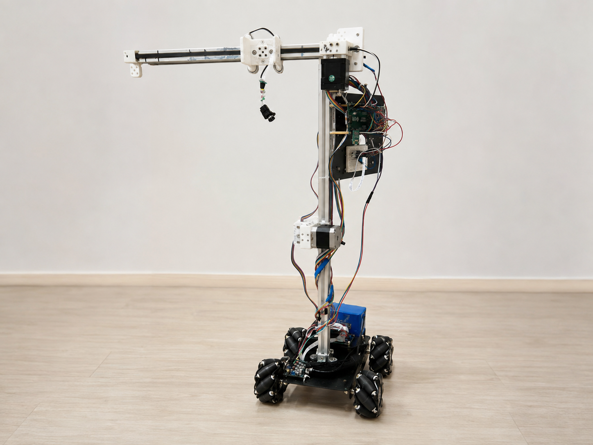
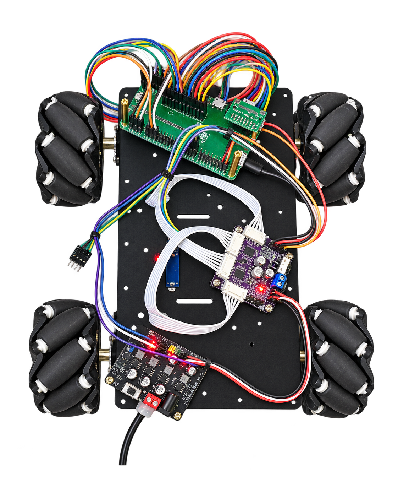

# 基于 RA8P1 的麦穗计数与环境监测系统

**RA8P1 · Ethos-U55 · YOLOX-Tiny · INT8 · 嵌入式视觉**

2026 年全国大学生电子设计竞赛信息科技前沿专题赛（瑞萨杯）决赛团队项目。系统面向小麦样本与样方调查，通过摄像头采集图像，在 RA8P1 上进行麦穗检测、计数与结果显示，并提供温湿度、光照采集、局域网交互和 SD 数据记录模块。

[技术报告](./技术文档.pdf) · [作品简介](./作品简介.pdf) · [答辩 PPT](./项目答辩.pptx) · [源码导航](./src/README.md)

## 1. 系统组成

| 模块 | 工作内容 |
|---|---|
| RA8P1 / Cortex-M85 | 图像采集、预处理、外设调度、检测后处理 |
| Ethos-U55 | 执行经 RUHMI 工具链部署的神经网络算子 |
| OV5640 | 采集麦穗图像 |
| ST7796S | 显示相机画面与检测结果 |
| DHT11 / 光照传感器 | 采集温湿度与相对光照 |
| ESP8266 | Wi-Fi 接入、局域网 HTTP / WebSocket 交互 |
| SD 卡 | 数据记录与导出 |
| TJC 串口屏 | 参数输入与人机交互工程 |

```text
OV5640 → RA8P1 / Cortex-M85
              ├─ 图像采集、分块与预处理
              ├─ Ethos-U55：YOLOX 推理
              ├─ 坐标恢复、全局 NMS 与计数
              ├─ ST7796S：图像与结果显示
              ├─ DHT11 / ADC：环境采集
              ├─ SD：数据记录
              └─ ESP8266：局域网网页交互
```


**版本说明：** 本页代码参数对应 2026-08-18 的 `camera` 工程快照，采用 `224×224` 分块推理；技术报告与 `report_core` 附录采用 `320×320` 方案。整机与底盘结构照片来自答辩 PPT。双核底盘、滑轨及整田任务属于整机集成方案，与视觉主工程分别说明。

## 2. 个人工作

本项目由团队合作完成。我主要负责**麦穗检测模型优化与移动底盘搭建**，工作集中在密集小目标处理、分块计数去重、INT8 部署适配及移动采样平台搭建。

### 密集麦穗检测与数据适配

围绕 YOLOX-Tiny 单类别 `wheat_head` 检测，处理麦穗密集、相互遮挡及光照变化带来的漏检与误检。数据方案结合 Global Wheat Head Detection 公开数据与 OV5640 场景样本，按采集场景或批次划分训练和验证数据，并统一边界目标、遮挡目标与穗芒的标注规则。


### 重叠分块、坐标恢复与全局去重

将整幅图像直接缩小会丢失小麦穗细节，因此在局部图块上检测，再回到原图坐标系汇总计数。

1. 将 `640×480` 图像划分为 `12` 个 `224×224` 图块，主步长为 `179` 像素，边缘图块调整起点以覆盖完整画面。
2. 将各块检测框叠加图块起点偏移，恢复到原图坐标。
3. 汇总候选框并执行全局 NMS，减少重叠区域的重复计数。工程默认置信度阈值为 `0.25`，NMS IoU 阈值为 `0.45`。

代码：[分块与解码](./src/camera/src/wheat_yolox_decode.c) · [全局后处理](./src/camera/src/wheat_postprocess.c)

### INT8 量化与端侧部署

对接相机像素格式、模型输入和 Ethos-U55 推理后端。tile224 路径将 RGB565 大端像素解包，按 BGR 顺序组织 INT8 输入，并执行像素值减 `128` 的转换；同步核对张量布局、量化参数和检测框格式。

模型转换过程中检查算子映射、CPU 回退与数据搬运，并用固定输入比较源模型、转换模型及板端的输出，检查张量数值、检测框、置信度和计数是否发生偏差。

代码：[图像预处理](./src/camera/src/wheat_preprocess.c) · [推理后端](./src/camera/src/wheat_ai_backend.c) · [模型部署工具](./src/camera/tools/wheat_deployment/) · [数值检查脚本](./src/camera/tools/run_yolox_tile224_numeric_gate.py)

### 移动底盘与采样机构

搭建四轮麦克纳姆移动平台，安装竖直支架与横向相机滑轨，将移动载体和视觉采样单元组合。采样方案由底盘承担区域间移动，滑轨负责局部取景，任务顺序为“移动、停稳、滑轨定位、图像采集、推理与记录”。

答辩方案中，Cortex-M33 承担底盘与滑轨控制，编码器和 JY61P 提供运动反馈；Cortex-M85 调度视觉处理与 Ethos-U55 推理。

[底盘照片](./images/chassis.png) · [滑轨采样单元](./images/slide_rail.png) · [答辩 PPT](./项目答辩.pptx)

## 3. 模型选型与部署记录

### 模型路线

| 路线 | 项目中的处理与取舍 |
|---|---|
| YOLOX-Tiny | 采用 `224×224` 重叠分块、坐标恢复与全局 NMS，接入 RUHMI / Ethos-U55 |
| YOLOv8n | 对 `full640` 和 `full320 QAT` 候选进行转换排查，记录置信度量化损失、检测丢失与 CPU Resize 回退问题 |
| YOLO-Fastest 1.1 | 作为轻量备选纳入模型选型说明 |

[选型说明](./src/camera/tools/wheat_deployment/RA8P1_YOLOX_TINY_WHEAT_TRAINING_HANDOFF.md#21-三种模型的核心区别) · [YOLOv8n full640 记录](./src/camera/tools/wheat_deployment/manifests/yolov8n_wheat_full640_candidate.json) · [full320 QAT 六头记录](./src/camera/tools/wheat_deployment/manifests/yolov8n_wheat_full320_qat_six_head_candidate.json)

### 转换问题定位

下表分别记录各候选在自身参考输入上的转换结果。

| 候选与输入 | FP32 参考 | INT8 结果 | 处理结论 |
|---|---|---|---|
| YOLOv8n `full640`，转换参考输入 | 最高置信度约 `0.785` | 最高置信度为 `0` | 排除该单输出量化方案 |
| YOLOX-Tiny 旧 `full224`，固定 `20` 张输入 | NMS 后合计 `671` 个检测 | 合计 `166` 个检测，相对 FP32 的单图计数 MAE 为 `25.25` | 排除该候选，后续采用 tile224 路线 |

数据来源：[YOLOv8n 候选记录](./src/camera/tools/wheat_deployment/manifests/yolov8n_wheat_full640_candidate.json) · [旧 YOLOX full224 记录](./src/camera/tools/wheat_deployment/manifests/yolox_tiny_gwhd_full224_candidate.json)

### tile224 转换一致性

| 检查范围 | 条件 | 记录结果 |
|---|---|---|
| 源 INT8 TFLite 与 RUHMI pre-Vela 子图 | 全 `-128` 与 pattern 两组确定性输入 | 两组输出逐字节一致；pattern 输出 `6174` 字节，差异数 `0` |
| 板端 post-Vela 与源模型检测结果 | `20` 帧、`240` 个分块；置信度 `0.25`、全局 NMS IoU `0.45`；按 IoU≥`0.50` 匹配 | 匹配召回率 `98.06%`、匹配精确率 `96.65%`、计数 MAE `1.0` |

这些指标以**源模型输出为参考**，衡量部署前后的结果一致性。记录见 [tile224 数值与板端检查文档](./src/camera/docs/yolox-tile224-pc-numeric-gate.md)。

## 4. 实物展示

### 整机与田间场景



答辩 PPT 中的整机照片，展示麦轮底盘、立式支架与横向采样单元。


### 底盘与核心板

| 麦克纳姆轮底盘 | RA8P1 控制板 |
|---|---|
|  |  |

### 人机交互


[串口屏工程](./src/hmi/) · [通信协议](./src/hmi/通信协议.md) · [图片来源](./images/README.md)

## 5. 关键代码与环境

| 模块 | 入口 |
|---|---|
| 主程序与服务调度 | [app.c](./src/camera/src/app.c) |
| 相机采集与帧缓冲 | [camera_capture.c](./src/camera/src/camera_capture.c) |
| 模型推理 | [wheat_ai_backend.c](./src/camera/src/wheat_ai_backend.c) |
| 分块解码与去重 | [wheat_yolox_decode.c](./src/camera/src/wheat_yolox_decode.c) · [wheat_postprocess.c](./src/camera/src/wheat_postprocess.c) |
| 环境采集 | [environment_service.c](./src/camera/src/environment_service.c) |
| 局域网页面 | [web_ui_page.inc](./src/camera/src/web_ui_page.inc) |
| SD 存储 | [storage_service.c](./src/camera/src/storage_service.c) |
| 主机测试 | [测试目录](./src/camera/tests/) · [模型测试脚本](./src/camera/tests/run_wheat_host_tests.ps1) |

工程环境记录为 e² studio `2026-04.2`、FSP `6.5.0`、GNU Arm Embedded `13.2.1`。导入方法、工程版本及测试入口见[源码与工程说明](./src/README.md)。

## 6. 第三方组件

工程使用 Renesas FSP / CMSIS / RUHMI、Ethos-U、YOLOX、FatFs 及相应厂商组件。
