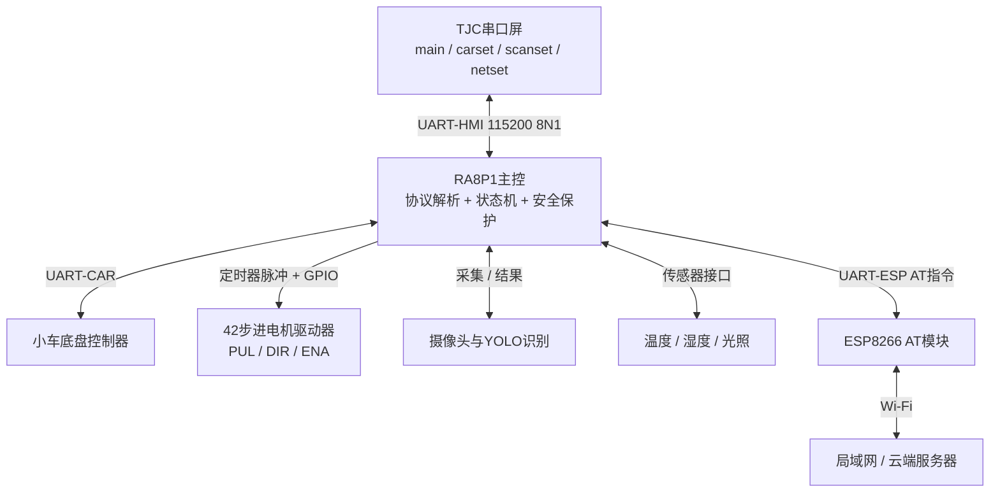
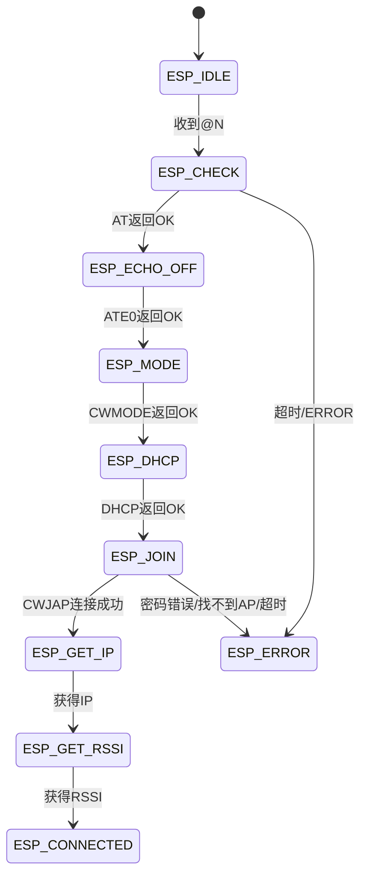

# WHEAT 小麦智能检测系统完整项目手册

> 文档版本：V3.1  
> 更新日期：2026-08-17  
> 串口屏工程：`WHEAT.HMI`  
> 主控平台：Renesas RA8P1  
> 串口屏：TJC4827X243_011，480×272，UTF-8  
> 网络模块：ESP8266（ESP-AT 固件）

---

## 1. 项目目标

本项目用于实验田小麦巡检与麦穗检测。设备安装在移动小车上，由 RA8P1 统一协调：

- 小车按设置的速度、距离、行间距、角度和行数自动巡检；
- 水平导轨使用 42 步进电机，带动摄像头分段移动和拍照；
- 视觉模型完成麦穗识别、计数和图像质量判断；
- 温度、湿度、相对光照等传感器数据在串口屏显示；
- ESP8266 连接 Wi-Fi，上传样本与检测结果；
- 串口屏负责参数设置、任务启动、状态监控和紧急停止；
- RA8P1 是唯一的任务状态机、安全仲裁者和通信中心。

串口屏不能直接驱动小车电机、步进电机或 ESP8266。所有执行动作必须由 RA8P1 校验后完成。

## 2. 总体架构



推荐 RA8P1 至少分配三路独立 UART：

| UART | 对象 | 建议参数 | 作用 |
|---|---|---|---|
| `UART_HMI` | 淘晶驰串口屏 | 115200，8N1 | 任务命令、页面数据更新 |
| `UART_CAR` | 小车底盘控制器 | 按底盘固件配置 | 速度命令和里程计遥测 |
| `UART_ESP` | ESP8266 | 先测试115200，必要时测试9600 | AT命令和网络数据 |

三路设备不能并接到同一 UART。

## 3. 工程目录清单

当前工程根目录：

```text
E:\大学学科竞赛\电赛邀请赛\国赛\串口屏
```

主要文件：

```text
串口屏\
├─ WHEAT.HMI                              当前串口屏工程
├─ WHEAT_backup_20260809_1736.HMI         早期工程备份
├─ WHEAT_HMI串口通信手册.md               V2.1通信手册
├─ WHEAT_HMI串口通信手册_V1_backup_20260816.md
├─ WHEAT字库字符补全.txt
├─ 素材\
│  ├─ 1.png
│  ├─ 2.png
│  ├─ 3.png
│  └─ 4.png
└─ 字库\
   ├─ WHEAT_14px_utf8.zi
   ├─ WHEAT_16px_utf8.zi
   ├─ WHEAT_18px_utf8.zi
   ├─ WHEAT_20px_utf8.zi
   ├─ WHEAT_24px_digits_utf8.zi
   ├─ font_charset_labels.txt
   ├─ font_charset_digits.txt
   ├─ make_fonts.ps1
   ├─ backup_20260816_2057\
   └─ backup_network_20260816_2210\
```

`WHEAT.HMI` 当前编辑器页面数为 4，项目采用：

```text
main
carset
scanset
netset
```

## 4. 串口屏基础设置

### 4.1 Program.s

当前基础配置应保持：

```c
int sys0=0,sys1=0,sys2=0

int gPatSpd=30,gSegDist=120,gRowGap=60
int gTurnAng=90,gRowCnt=4
int gScanDist=300,gShotGap=50
int gRailSpd=20,gStartShot=1

baud=115200
dim=100
recmod=0
bkcmd=0
page 0
```

说明：

- `baud=115200`：串口屏运行波特率；
- `recmod=0`：字符串指令模式；
- `bkcmd=0`：正式运行不返回每条指令的执行结果；
- 调试 HMI 原生命令时可临时设 `bkcmd=3`；
- 不保留无意义的上电 `printh 00 00 ...`；
- Program.s 全局变量目前只使用整数，网络 SSID、密码由页面字符串变量暂存，最终由 MCU 保存。

### 4.2 颜色规范

| 用途 | RGB565十进制 |
|---|---:|
| 页面背景 | `65` |
| 卡片背景 | `2242` |
| 普通按钮背景 | `4355` |
| 普通按钮按下 | `6598` |
| 主按钮绿色 | `5068` |
| 主按钮按下 | `4841` |
| 标题白色 | `63422` |
| 纯白 | `65535` |
| 次级灰色 | `44437` |
| 正常绿色 | `13971` |
| 数据浅绿色 | `30519` |
| 黄色提示 | `65098` |
| 红色故障/急停 | `62123` |
| 急停按下 | `45414` |

### 4.3 字库规范

| 字库 | 用途 |
|---|---|
| `WHEAT14` | 标签、单位、网络状态、检测信息 |
| `WHEAT16` | 区域标题、普通按钮、导航 |
| `WHEAT18` | 主状态、主要操作按钮 |
| `WHEAT20` | 页面标题、重要数值 |
| `WHEAT24D` | 大号数字（可选） |

当前字库已经补入检测结果和网络页字符，包括：

```text
检测完成 结果已更新 质量良好 已上传
网络设置 名称 密码 连接 断开 刷新 信号强度
连接中 已连接 连接失败 密码错误 连接超时 网络异常
```

更换 `.zi` 文件时必须在编辑器中使用“替换字库”，不要删除后重新添加，否则字体 ID 会变化。

## 5. 页面与控件

所有新增控件名称继续遵守“不超过14字节”。已有控件名称不得擅自改动。

### 5.1 main：运行监控主页

| 功能 | 真实控件名 | 类型 | MCU更新 |
|---|---|---|---|
| 页面标题 | `tTitle` | 文本 | 否 |
| 系统/网络状态 | `tSysState` | 文本 | 是 |
| 麦穗数量 | `nCount` | 数字 | 是 |
| 温度 | `xTemp` | 虚拟浮点 | 是 |
| 湿度 | `xHum` | 虚拟浮点 | 是 |
| 相对光照 | `nLight` | 数字 | 是 |
| 检测状态标题 | `tDetTit` | 文本 | 否 |
| 状态背景 | `tDetectBg` | 背景文本 | 否 |
| 主任务状态 | `tDetectState` | 文本 | 是 |
| 副任务状态 | `tDetSub` | 文本 | 是 |
| 检测信息标题 | `tInfoTitle` | 文本 | 否 |
| 信息背景 | `tInfoBg` | 背景文本 | 否 |
| 图像质量 | `tQuality` | 文本 | 是 |
| 耗时 | `tTime` | 文本 | 是 |
| 样本号 | `tSample` | 文本 | 是 |
| 上传状态 | `tUpload` | 文本 | 是 |
| 自动巡检 | `bPatrol` | 按钮 | 发完整 `@A` |
| 采集识别 | `bSearch` | 按钮 | 发小车字段全零的 `@A` |
| 小车参数入口 | `bCapture` | 按钮 | `page carset` |
| 导轨参数入口 | `bReturn` | 按钮 | `page scanset` |
| 紧急停止 | `bStop` | 按钮 | 发 `@E\n` |
| 网络入口热区 | `mNetSet` | 触摸热区 | `page netset` |

`mNetSet` 覆盖在 `tSysState` 上方。建议 `tSysState` 显示：

```text
网络正常 >
网络未连 >
网络异常 >
```

### 5.2 carset：小车巡检参数

| 参数 | 控件名 | 单位 | 范围 | 步长 |
|---|---|---:|---:|---:|
| 巡检速度 | `nPatSpd` | % | 10～100 | 5 |
| 单行/单段距离 | `nSegDist` | cm | 20～500 | 10 |
| 行间距 | `nRowGap` | cm | 20～150 | 5 |
| 转向角度 | `nTurnAng` | ° | 45～180 | 15 |
| 巡检行数 | `nRowCnt` | 行 | 1～20 | 1 |
| 保存状态 | `tSaveSt` | 文本 | 已保存/未保存 | — |

保存按钮 `bCarSave`：

```c
gPatSpd=nPatSpd.val
gSegDist=nSegDist.val
gRowGap=nRowGap.val
gTurnAng=nTurnAng.val
gRowCnt=nRowCnt.val

tSaveSt.txt="已保存"
tSaveSt.pco=13971
```

保存只更新屏幕全局变量，不启动任务。

### 5.3 scanset：导轨扫描参数

| 参数 | 控件名 | 单位 | 范围 | 步长 |
|---|---|---:|---:|---:|
| 扫描距离 | `nScanDist` | mm | 50～300 | 10 |
| 拍照间隔 | `nShotGap` | mm | 10～150 | 10 |
| 拍照张数 | `nShotCnt` | 张 | 自动计算 | 不可直接修改 |
| 导轨速度 | `nRailSpd` | mm/s | 5～50 | 5 |
| 起点拍照 | `btStartShot` | 0/1 | 关闭/开启 | — |
| 保存状态 | `tScanSt` | 文本 | 已保存/未保存 | — |

保存按钮 `bScanSave`：

```c
gScanDist=nScanDist.val
gShotGap=nShotGap.val
gRailSpd=nRailSpd.val
gStartShot=btStartShot.val

tScanSt.txt="已保存"
tScanSt.pco=13971
```

屏幕拍照张数采用拆行运算，避免淘晶驰表达式括号问题：

```c
nShotCnt.val=nScanDist.val+nShotGap.val
nShotCnt.val=nShotCnt.val-1
nShotCnt.val=nShotCnt.val/nShotGap.val

if(btStartShot.val==1)
{
  nShotCnt.val=nShotCnt.val+1
}
```

主控必须再次独立计算，不能盲信屏幕的 `nShotCnt`。

### 5.4 netset：ESP8266 网络设置

ESP8266 第一版固定使用 Station + DHCP，不需要用户手动输入静态 IP。若页面已经建立 `btDhcp`，建议固定为开启并隐藏，或保留只读显示。

推荐控件：

| 控件名 | 类型 | 内容/作用 |
|---|---|---|
| `bNetBack` | 按钮 | 返回主页 |
| `tNetTitle` | 文本 | 网络设置 |
| `tNetState` | 文本 | 未连接/连接中/已连接/失败 |
| `tSSIDLab` | 文本 | Wi-Fi名称 |
| `tSSID` | 输入/文本 | SSID，最大32字节 |
| `tPwdLab` | 文本 | Wi-Fi密码 |
| `tPwd` | 输入/文本 | 密码输入缓冲区64字节；协议有效载荷最大63字节 |
| `tIPLab` | 文本 | 当前IP |
| `tIPAddr` | 文本 | 0.0.0.0 |
| `tRSSILab` | 文本 | 信号强度 |
| `tRSSI` | 文本 | -- dBm |
| `bNetConn` | 按钮 | 保存并连接 |
| `bNetDisc` | 按钮 | 断开网络 |
| `bNetGet` | 按钮 | 刷新状态 |
| `vaNetFrm` | 字符串变量 | 组装网络帧，`txt_maxl`必须设为128 |
| `vaNetTmp` | 字符串变量 | 临时转换 |

`bNetConn` 弹起事件：

```c
vaNetFrm.txt="@N,"
vaNetFrm.txt+=tSSID.txt
vaNetFrm.txt+=","
vaNetFrm.txt+=tPwd.txt

prints vaNetFrm.txt,0
printh 0A

tNetState.txt="连接中"
tNetState.pco=65098
```

`bNetDisc`：

```c
prints "@D",0
printh 0A
tNetState.txt="断开中"
tNetState.pco=65098
```

`bNetGet`：

```c
prints "@G",0
printh 0A
```

`bNetBack`：

```c
page main
```

当前简单协议要求 SSID 和密码不能包含英文逗号、CR 或 LF。生产版本若需支持任意特殊字符，应升级为长度字段协议。

已完成实机验证：当 `vaNetFrm.txt_maxl` 过小时，`@N,`、SSID 和分隔符会先占用缓冲区，密码 `123456789` 曾被截断为 `1234`。将该属性改为 `128` 后发送恢复完整。因此这不是字体库或 `tPwd` 显示宽度问题，而是拼接变量容量不足。网络输入控件必须统一设置为：

```text
tSSID.txt_maxl   = 32
tPwd.txt_maxl    = 64
vaNetFrm.txt_maxl = 128
```

验证用帧：

```text
@N,yanqin,123456789\n
```

XCOM ASCII 接收应完整显示上述一行；十六进制结尾必须是 `0A`，不能在 HMI 上行帧后追加 `FF FF FF`。

### 5.5 动态控件作用域

需要异步跨页更新的控件设为 `vscope=全局`：

```text
nCount xTemp xHum nLight
tSysState tDetectState tDetSub
tQuality tTime tSample tUpload
tNetState tIPAddr tRSSI
```

建议：

```text
tDetectState.txt_maxl >= 24
tDetSub.txt_maxl      >= 32
tQuality.txt_maxl     >= 32
tTime.txt_maxl        >= 32
tSample.txt_maxl      >= 32
tUpload.txt_maxl      >= 32
tSSID.txt_maxl        >= 32
tPwd.txt_maxl         >= 64
tIPAddr.txt_maxl      >= 20
vaNetFrm.txt_maxl      = 128
```

## 6. 正式通信协议总表

### 6.1 串口屏到 RA8P1

| 帧 | 作用 |
|---|---|
| `@A,p1,p2,p3,p4,p5,p6,p7,p8,p9\n` | 自动巡检或仅导轨扫描 |
| `@E\n` | 紧急停止 |
| `@N,SSID,PASSWORD\n` | 保存网络参数并连接 |
| `@D\n` | 断开Wi-Fi |
| `@G\n` | 查询网络状态 |

以下旧协议全部废弃：

```text
A5 CMD 5A
@Q
@AUTO#
@CARCFG,...#
@SCANCFG,...#
```

### 6.2 统一任务帧 `@A`

```text
@A,PAT_SPD,SEG_DIST,ROW_GAP,TURN_ANG,ROW_CNT,SCAN_DIST,SHOT_GAP,RAIL_SPD,START_SHOT\n
```

自动巡检示例：

```text
@A,30,120,60,90,4,300,50,20,1\n
```

仅采集识别示例：

```text
@A,0,0,0,0,0,300,50,20,1\n
```

判定规则：

```text
前5个小车字段全为0       -> 小车强制停止，仅运行导轨
前5个小车字段全合法非0   -> 自动巡检
前5个字段部分为0          -> 非法帧，拒绝执行
```

字段范围：

| 字段 | 单位 | 范围 |
|---|---|---|
| `PAT_SPD` | % | 10～100，扫描模式为0 |
| `SEG_DIST` | cm | 20～500，扫描模式为0 |
| `ROW_GAP` | cm | 20～150，扫描模式为0 |
| `TURN_ANG` | ° | 45～180，扫描模式为0 |
| `ROW_CNT` | 行 | 1～20，扫描模式为0 |
| `SCAN_DIST` | mm | 50～300 |
| `SHOT_GAP` | mm | 10～150 |
| `RAIL_SPD` | mm/s | 5～50 |
| `START_SHOT` | 布尔 | 0或1 |

### 6.3 自动巡检按钮发送代码

`bPatrol` 的按下事件为空，弹起事件发送一帧：

```c
covx gPatSpd,vaTmp.txt,0,0
vaFrame.txt="@A,"+vaTmp.txt
covx gSegDist,vaTmp.txt,0,0
vaFrame.txt+=","+vaTmp.txt
covx gRowGap,vaTmp.txt,0,0
vaFrame.txt+=","+vaTmp.txt
covx gTurnAng,vaTmp.txt,0,0
vaFrame.txt+=","+vaTmp.txt
covx gRowCnt,vaTmp.txt,0,0
vaFrame.txt+=","+vaTmp.txt
covx gScanDist,vaTmp.txt,0,0
vaFrame.txt+=","+vaTmp.txt
covx gShotGap,vaTmp.txt,0,0
vaFrame.txt+=","+vaTmp.txt
covx gRailSpd,vaTmp.txt,0,0
vaFrame.txt+=","+vaTmp.txt
covx gStartShot,vaTmp.txt,0,0
vaFrame.txt+=","+vaTmp.txt
prints vaFrame.txt,0
printh 0A
```

### 6.4 采集识别按钮发送代码

`bSearch` 的按下事件为空，弹起事件：

```c
vaFrame.txt="@A,0,0,0,0,0"
covx gScanDist,vaTmp.txt,0,0
vaFrame.txt+=","+vaTmp.txt
covx gShotGap,vaTmp.txt,0,0
vaFrame.txt+=","+vaTmp.txt
covx gRailSpd,vaTmp.txt,0,0
vaFrame.txt+=","+vaTmp.txt
covx gStartShot,vaTmp.txt,0,0
vaFrame.txt+=","+vaTmp.txt
prints vaFrame.txt,0
printh 0A
```

### 6.5 紧急停止

`bStop` 必须放在按下事件：

```c
prints "@E",0
printh 0A
```

收到 `@E` 后 MCU 立即锁存急停。新的 `@A` 不允许自动解除急停。

## 7. 小车底盘通信

### 7.1 RA8P1 到小车

```text
$vx,vy,wz\n
```

| 字段 | 单位 | 正方向 |
|---|---|---|
| `vx` | m/s | 正值前进 |
| `vy` | m/s | 正值左移 |
| `wz` | rad/s | 正值逆时针 |

示例：

```text
$0.5,0.0,0.0\n
$0.0,0.3,0.0\n
$0.0,0.0,1.57\n
$0.0,0.0,0.0\n
```

### 7.2 小车到 RA8P1

```text
$x,y,yaw,vx,vy,wz\r\n
```

周期：50ms（20Hz）。MCU 必须记录最后一次有效遥测时间，超过200ms未收到有效帧应停止小车并暂停任务。

### 7.3 行驶距离

每段开始保存起点：

```c
start_x = odom.x;
start_y = odom.y;
start_yaw = odom.yaw;
```

沿起始方向的进度：

```c
float dx = odom.x - start_x;
float dy = odom.y - start_y;
float progress_m = dx * cosf(start_yaw) + dy * sinf(start_yaw);
```

到达：

```c
progress_m >= config.segment_distance_cm / 100.0f
```

时停止。不能只比较全局 `x`。

## 8. 导轨与42步进电机

### 8.1 接口

```text
RA8P1 TIMER/PWM -> 驱动器 PUL
RA8P1 GPIO      -> 驱动器 DIR
RA8P1 GPIO      -> 驱动器 ENA
左/原点限位      -> RA8P1 GPIO/外部中断
右限位           -> RA8P1 GPIO/外部中断
```

MCU GPIO 不得直接连接电机绕组。

### 8.2 脉冲换算

```text
pulses_per_mm = 每圈整步数 × 细分 / 丝杆导程(mm)
target_pulses = 距离(mm) × pulses_per_mm
frequency_hz  = 速度(mm/s) × pulses_per_mm
```

例如1.8°电机、16细分、4mm导程：

```text
200 × 16 / 4 = 800 pulse/mm
20mm/s -> 16000Hz
```

### 8.3 扫描点

```c
segments = (scan_distance_mm + shot_gap_mm - 1U) / shot_gap_mm;
shots = segments + (start_shot ? 1U : 0U);
```

若不能整除，最后一个拍照点固定为扫描终点，不能越过机械行程。

### 8.4 回零

1. 低速向原点移动；
2. 触发原点开关立即停止；
3. 位置清零；
4. 可反向退出并二次低速靠近；
5. 回零超时进入故障；
6. 自动任务结束后建议导轨回零。

## 9. ESP8266 网络模块

### 9.1 接线

```text
RA8P1 UART_ESP_TX -> ESP8266 RX
RA8P1 UART_ESP_RX <- ESP8266 TX
RA8P1 GND         <-> ESP8266 GND
稳定3.3V          -> ESP8266 VCC
稳定3.3V          -> ESP8266 EN/CH_PD
```

ESP8266 只能使用3.3V电源和3.3V串口电平。电源应能承受无线发射时的瞬时电流，不能由普通GPIO供电。

### 9.2 启动测试

先用 UART_ESP 发送：

```text
AT\r\n
```

收到 `OK` 才说明波特率和接线正确。ESP8266 固件可能为115200或9600，应先实测。

### 9.3 连接状态机



顺序发送：

```text
AT\r\n
ATE0\r\n
AT+CWMODE=1\r\n
AT+CWDHCP=1,1\r\n
AT+CWJAP="SSID","PASSWORD"\r\n
AT+CIPSTA?\r\n
AT+CWJAP?\r\n
```

每条命令必须等待 `OK` 或 `ERROR`，不能连续无等待发送，否则可能收到 `busy`。

`AT+CWJAP` 常见错误码：

| 错误码 | 含义 | HMI提示 |
|---:|---|---|
| 1 | 连接超时 | 连接超时 |
| 2 | 密码错误 | 密码错误 |
| 3 | 找不到目标AP | 未找到网络 |
| 4 | 连接失败 | 连接失败 |

断开连接：

```text
AT+CWQAP\r\n
```

查询 IP：

```text
AT+CIPSTA?\r\n
```

查询当前 AP 与 RSSI：

```text
AT+CWJAP?\r\n
```

### 9.4 网络配置保存

推荐做法：

1. 串口屏发送 `@N,SSID,PASSWORD\n`；
2. RA8P1先将数据放入RAM；
3. ESP8266成功获得IP后，RA8P1才将配置写入数据Flash；
4. 保存时附加长度、版本和CRC；
5. 不在串口屏长期明文显示密码；
6. 避免每次进入页面都写Flash。

## 10. RA8P1 软件结构

推荐文件划分：

```text
hmi_uart.c/.h             串口屏UART、环形缓冲、发送队列
hmi_protocol.c/.h         @A/@E/@N/@D/@G解析
hmi_display.c/.h          MCU回写HMI原生命令
car_protocol.c/.h         $vx,vy,wz和里程计帧
rail_control.c/.h         PUL/DIR/ENA、回零、限位
esp8266_at.c/.h           ESP AT命令和响应解析
network_manager.c/.h      联网状态、配置保存、上传
task_state_machine.c/.h   自动巡检和仅扫描
sensor_manager.c/.h       温湿度、光照
sample_store.c/.h         A001编号和样本记录
safety_manager.c/.h       急停、超时、故障锁存
```

UART回调只搬运字节和记录发送完成，不在中断中解析字符串、控制电机、写Flash或更新大量HMI文字。

### 10.1 FSP UART 回调

```c
void hmi_uart_callback(uart_callback_args_t *p_args)
{
    if (p_args->event == UART_EVENT_RX_CHAR)
    {
        hmi_rx_ring_push_from_isr((uint8_t)p_args->data);
    }
    else if (p_args->event == UART_EVENT_TX_COMPLETE)
    {
        hmi_tx_complete_from_isr();
    }
    else if ((p_args->event == UART_EVENT_ERR_OVERFLOW) ||
             (p_args->event == UART_EVENT_ERR_FRAMING)  ||
             (p_args->event == UART_EVENT_ERR_PARITY))
    {
        hmi_uart_error_from_isr(p_args->event);
    }
}
```

FSP 的 `R_SCI_UART_Write()` 是异步发送，缓冲区必须保持有效直到 `UART_EVENT_TX_COMPLETE`。不能把局部栈数组传入后立即复用，应建立静态发送队列。

### 10.2 HMI逐字节收帧

```c
#define HMI_FRAME_MAX 160U

typedef struct
{
    char data[HMI_FRAME_MAX];
    uint16_t length;
    bool collecting;
} hmi_parser_t;

bool hmi_feed(hmi_parser_t *p, uint8_t ch)
{
    if (ch == '@')
    {
        p->length = 0U;
        p->collecting = true;
        p->data[p->length++] = '@';
        return false;
    }

    if (!p->collecting) return false;
    if (ch == '\r') return false;

    if (ch == '\n')
    {
        p->data[p->length] = '\0';
        p->collecting = false;
        return true;
    }

    if (p->length >= HMI_FRAME_MAX - 1U)
    {
        p->length = 0U;
        p->collecting = false;
        return false;
    }

    p->data[p->length++] = (char)ch;
    return false;
}
```

完整帧后按前缀分发：

```c
if (strcmp(frame, "@E") == 0)             emergency_stop_latch();
else if (strncmp(frame, "@A,", 3) == 0)   parse_task_frame(frame);
else if (strncmp(frame, "@N,", 3) == 0)   parse_network_frame(frame);
else if (strcmp(frame, "@D") == 0)        network_disconnect();
else if (strcmp(frame, "@G") == 0)        network_report_status();
else                                       protocol_error_count++;
```

网络帧解析必须由 MCU 再次校验，不能只依赖串口屏输入限制：

```c
#define WIFI_SSID_MAX_LEN 32U
#define WIFI_PWD_MAX_LEN  63U

bool parse_network_frame(char *frame,
                         char ssid[WIFI_SSID_MAX_LEN + 1U],
                         char password[WIFI_PWD_MAX_LEN + 1U])
{
    char *separator;
    size_t ssid_len;
    size_t password_len;

    if ((frame == NULL) || (strncmp(frame, "@N,", 3U) != 0))
    {
        return false;
    }

    separator = strchr(frame + 3, ',');
    if ((separator == NULL) || (strchr(separator + 1, ',') != NULL))
    {
        return false;
    }

    ssid_len = (size_t)(separator - (frame + 3));
    password_len = strlen(separator + 1);

    if ((ssid_len < 1U) || (ssid_len > WIFI_SSID_MAX_LEN) ||
        (password_len < 8U) || (password_len > WIFI_PWD_MAX_LEN))
    {
        return false;
    }

    memcpy(ssid, frame + 3, ssid_len);
    ssid[ssid_len] = '\0';
    memcpy(password, separator + 1, password_len + 1U);
    return true;
}
```

说明：

- 第一版只接受一个英文逗号分隔符，所以 SSID 和密码不能包含逗号；
- 当前按 WPA/WPA2 常用规则要求密码为8～63字节，暂不接受开放网络空密码；
- `HMI_FRAME_MAX=160` 为完整 `@N` 帧、任务帧和结尾空字符留出了余量；
- 解析成功后复制配置并启动非阻塞网络状态机，不得在 UART 中断中等待 ESP8266；
- 调试日志不得输出明文密码。

### 10.3 自动任务状态机

```c
typedef enum
{
    TASK_IDLE = 0,
    TASK_CAR_MOVE,
    TASK_CAR_STABILIZE,
    TASK_RAIL_HOME,
    TASK_RAIL_SCAN,
    TASK_DETECT,
    TASK_SAVE_SAMPLE,
    TASK_CHANGE_ROW,
    TASK_UPLOAD,
    TASK_COMPLETE,
    TASK_ERROR,
    TASK_ESTOP
} task_state_t;
```

自动巡检：

```text
合法完整@A
-> 小车行驶规定距离
-> 停车并等待稳定
-> 导轨回零和分段拍照
-> YOLO识别
-> 保存样本
-> 未完成行数则换行
-> 达到行数后停止、回零、上传
```

采集识别：

```text
小车字段全零的@A
-> 立即发送$0.0,0.0,0.0\n
-> 不进入任何小车距离/转向运算
-> 导轨回零、扫描、识别、保存
-> 导轨回零
-> 返回空闲
```

## 11. MCU回写串口屏

### 11.1 结束符

主控给淘晶驰发送的每条原生命令必须追加三个原始字节：

```text
FF FF FF
```

不是字符形式的 `"FF FF FF"`，也不是换行。

### 11.2 发送接口

```c
bool hmi_send_command(const char *cmd)
{
    size_t length = strlen(cmd);
    if (length + 3U > HMI_TX_SLOT_SIZE) return false;

    uint8_t frame[HMI_TX_SLOT_SIZE];
    memcpy(frame, cmd, length);
    frame[length++] = 0xFFU;
    frame[length++] = 0xFFU;
    frame[length++] = 0xFFU;

    return hmi_tx_queue_copy(frame, length);
}
```

### 11.3 传感器显示

```text
main.nCount.val=126
main.xTemp.val=256
main.xHum.val=605
main.nLight.val=78
```

其中：

```text
xTemp.vvs1=1，256显示25.6
xHum.vvs1=1，605显示60.5
```

建议环境数据每500～1000ms刷新一次，且只在数值变化时发送。

### 11.4 检测状态

```text
main.tSysState.txt="系统运行"
main.tDetectState.txt="分段扫描中"
main.tDetSub.txt="3 / 7"
```

检测完成：

```text
main.tDetectState.txt="检测完成"
main.tDetSub.txt="结果已更新"
main.tQuality.txt="质量：良好"
main.tTime.txt="耗时：328 ms"
main.tSample.txt="样本：A001"
main.tUpload.txt="上传：已上传"
```

### 11.5 网络状态

连接成功：

```text
netset.tNetState.txt="已连接"
netset.tNetState.pco=13971
netset.tIPAddr.txt="192.168.1.105"
netset.tRSSI.txt="-55 dBm"
main.tSysState.txt="网络正常 >"
main.tSysState.pco=13971
```

连接失败：

```text
netset.tNetState.txt="连接失败"
netset.tNetState.pco=62123
main.tSysState.txt="网络异常 >"
main.tSysState.pco=62123
```

## 12. 样本记录

`A001` 表示一个完整采样点，不表示单张图片。一次导轨扫描的图片：

```text
A001_01.jpg
A001_02.jpg
...
A001_07.jpg
```

推荐记录：

```csv
sample_id,time,row,segment,x,y,yaw,temp,hum,light,wheat_count,quality,infer_ms,upload
A001,2026-08-17 10:30:00,1,2,1.234,0.567,0.785,25.6,60.5,78,126,good,328,0
```

只有图片和记录全部保存成功后，才增加样本号。编号应保存到带CRC和磨损均衡的数据Flash、SD卡或文件系统，避免断电后重复使用 `A001`。

## 13. 里程计漂移

实验田松软地面会导致轮胎打滑，轮式里程计必然累计漂移。建议：

```text
轮编码器 + IMU航向融合
        +
行端视觉标志 / AprilTag / UWB / RTK绝对校正
```

最低要求：

1. 上电静止标定IMU零偏；
2. 标定轮径、轮距、编码器脉冲比例；
3. 每一段采用相对起点计算位移；
4. 每行端点重新校正航向和横向位置；
5. 采集前确认车辆稳定300～500ms；
6. 超出横向/航向阈值立即停车并重新定位。

初始保护阈值可从以下数值开始现场调整：

```text
横向偏差 > 0.15m
航向误差 > 8°
遥测超时 > 200ms
```

## 14. 安全停止条件

| 条件 | 必须动作 |
|---|---|
| 收到 `@E` | 立即停小车、停导轨、锁存急停 |
| HMI参数非法 | 拒绝任务并保持执行器停止 |
| 小车遥测超时 | 发送零速度，暂停任务 |
| 导轨回零超时 | 关闭脉冲，进入故障 |
| 限位方向冲突 | 禁止继续向该方向 |
| 摄像头失败 | 停止当前采样步骤 |
| YOLO识别失败 | 保留图片并记录失败 |
| 样本存储失败 | 不增加样本号 |
| Wi-Fi失败 | 本地保存，显示未上传，不影响紧急停止 |

安全动作优先于屏幕显示。即使 HMI UART 故障，也必须先停止执行器。

## 15. 联调步骤

### 15.1 串口屏

1. 编译 `WHEAT.HMI`，确认0错误；
2. 下载后用XCOM验证按钮只发送一帧；
3. 自动巡检应得到完整 `@A`；
4. 采集识别应得到前5项全零的 `@A`；
5. 急停应立即得到 `@E 0A`；
6. 网络连接应得到 `@N,SSID,PASSWORD 0A`；
7. 所有发送按钮关闭“定时发送”。

### 15.2 HMI回写

XCOM使用十六进制发送，数量126：

```text
6D 61 69 6E 2E 6E 43 6F 75 6E 74 2E 76 61 6C 3D 31 32 36 FF FF FF
```

依次验证 `xTemp`、`xHum`、`nLight`、检测状态、检测信息和网络状态。

### 15.3 ESP8266

1. 单独供电；
2. `AT` 返回 `OK`；
3. `AT+CWMODE=1` 成功；
4. `AT+CWJAP` 成功；
5. `AT+CIPSTA?` 获得IPv4；
6. `AT+CWJAP?` 获得RSSI；
7. 断开路由器，验证自动重连和HMI错误显示。

### 15.4 自动任务

分别测试：

- 小车移动中急停；
- 转向中急停；
- 导轨回零中急停；
- 扫描中急停；
- 识别中急停；
- 小车遥测断开；
- 原点开关失效；
- Wi-Fi断开；
- 存储空间不足。

## 16. 开发验收清单

- [ ] 串口屏、底盘和ESP8266使用独立UART。
- [ ] 所有UART TX/RX交叉并共地。
- [ ] ESP8266使用稳定3.3V电源和3.3V逻辑。
- [ ] HMI接收器能处理分包、粘包、CRLF、超长帧和乱码。
- [ ] `@A`严格解析9个整数。
- [ ] 前5字段全零只执行导轨。
- [ ] 前5字段部分为零被拒绝。
- [ ] `@E`在任何状态下具有最高优先级。
- [ ] 新任务不能自动解除急停。
- [ ] 导轨具备原点、右限位、回零超时和行程限制。
- [ ] 小车遥测超过200ms停止。
- [ ] MCU到HMI每条指令追加原始 `FF FF FF`。
- [ ] HMI异步发送使用静态队列，缓冲区保持到TX_COMPLETE。
- [ ] 温湿度按10倍定点数显示。
- [ ] 网络失败时样本保留在本地。
- [ ] 样本保存成功后才递增编号。
- [ ] 所有动态中文均包含在字库中。
- [ ] 修改协议、字段或控件名时同步更新本手册。

## 17. 当前版本边界与后续任务

当前已经确定：

- 4个串口屏页面及其职责；
- `@A`统一任务协议；
- `@E`急停协议；
- 小车速度和遥测协议；
- 42步进电机导轨控制原则；
- 传感器和检测结果回写格式；
- `@N/@D/@G`网络控制协议；
- ESP8266 Station + DHCP 的AT流程；
- 样本编号与里程计漂移处理原则。

尚需在实机项目中完成或确认：

1. RA8P1具体SCI通道和引脚分配；
2. ESP8266实际AT固件版本与串口波特率；
3. Wi-Fi配置的Flash存储格式；
4. 上传服务器IP、端口、TCP/UDP/HTTP/MQTT协议；
5. 小车最大速度与速度百分比映射；
6. 丝杆导程、驱动细分和 `pulses_per_mm` 标定；
7. 限位开关有效电平和消抖；
8. 视觉模型结果接口与图片保存位置；
9. 物理急停和软件复位流程；
10. `netset` 输入键盘与密码隐藏方式。

## 18. 参考资料

- Renesas FSP SCI UART：<https://renesas.github.io/fsp/group___s_c_i___u_a_r_t.html>
- Renesas FSP UART Interface：<https://renesas.github.io/fsp/group___u_a_r_t___a_p_i.html>
- ESP8266 ESP-AT Wi-Fi指令：<https://docs.espressif.com/projects/esp-at/en/release-v2.2.0.0_esp8266/AT_Command_Set/Wi-Fi_AT_Commands.html>
- ESP8266 ESP-AT硬件连接：<https://docs.espressif.com/projects/esp-at/en/release-v2.2.0.0_esp8266/Get_Started/Hardware_connection.html>

---

本手册是当前 WHEAT 小麦智能检测系统的项目总基准。串口屏、RA8P1、小车控制器、导轨程序和ESP8266代码必须遵守同一份字段、单位、状态和安全规则；任何一端发生变更，都应先修改本文档并记录版本。
