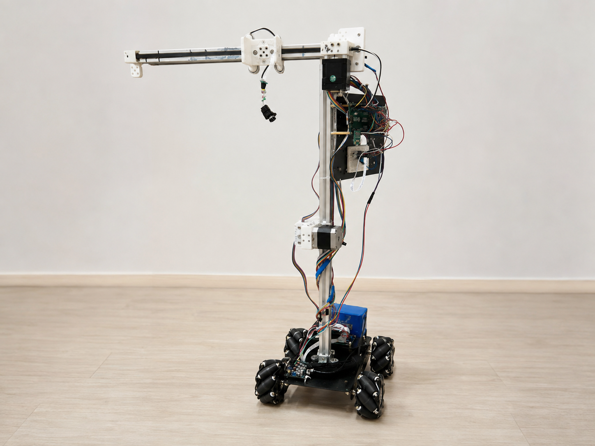

# 基于 RA8P1 的小麦麦穗智能计数与环境监测系统

**RA8P1 Wheat Inspection | OV5640 · Ethos-U55 · YOLOX · ESP8266**

> 瑞萨杯决赛团队项目。[技术报告](../../materials/ra8p1/技术报告.pdf) · [作品简介](../../materials/ra8p1/作品简介.pdf) · [项目答辩](../../materials/ra8p1/项目答辩.pptx)

## 1. 项目概览 | Overview

系统面向小麦样本计数、图像复核与环境信息记录。实际产品主工程快照为 `camera`；报告附录核心代码、独立串口屏工程分别保留。

本人负责**模型优化与底盘搭建**。本目录的全部产品代码与第三方生成代码属于团队项目资料，不按文件所在位置推定个人作者身份。

## 2. 系统架构与核心代码 | Architecture & Code

| 目录 | 用途 | 关键入口 |
|---|---|---|
| [camera](./camera/) | 2026-08-18 RA8P1 产品主工程快照 | [configuration.xml](./camera/configuration.xml)、[app.c](./camera/src/app.c) |
| [camera/src](./camera/src/) | 采集、显示、推理、环境、网络与存储 | [wheat_ai_backend.c](./camera/src/wheat_ai_backend.c)、[wheat_preprocess.c](./camera/src/wheat_preprocess.c)、[wheat_postprocess.c](./camera/src/wheat_postprocess.c) |
| [camera/tools](./camera/tools/) | 模型部署与数值检查 | [wheat_deployment](./camera/tools/wheat_deployment/) |
| [camera/tests](./camera/tests/) | 原工程已有的主机测试 | [run_host_tests.ps1](./camera/tests/run_host_tests.ps1)、[run_wheat_host_tests.ps1](./camera/tests/run_wheat_host_tests.ps1) |
| [report_core](./report_core/) | 报告附录 C99 核心程序，板级与模型待适配 | [README](./report_core/README.md) |
| [hmi](./hmi/) | 独立保存的 TJC 串口屏工程、字体与素材 | [WHEAT.HMI](./hmi/WHEAT.HMI) |

主工程保留内部目录结构与模型相关文件，未用附录代码覆盖产品代码。原始压缩包中文文件名已按正确编码提取。

## 3. 个人贡献 | My Contributions

- 模型优化：负责项目模型优化；部署与验证工具作为项目技术资料保留，个人优化的具体版本与对比指标待补充。
- 底盘搭建：负责底盘搭建；2026-08-18 快照中 M33 运动闭环与整田巡检仍列为后续集成，不据此宣称全部运动固件已完成。

## 4. 项目实验与结果 | Experiments & Results

**整机实物照片，来自答辩 PPT 第 9 页。** 展示麦轮底盘、支架与横向采样单元；另见 [田间照片](../../images/ra8p1/field_robot.png)。当前配图全部选自 PPT，来源见 [图片索引](../../docs/IMAGE_SOURCES.md)。

保存的 2026-08-18 源码快照与后续 PPT 照片对应不同时间点，阶段结果与实现边界已概括在 [版本说明](../../docs/VERSION_STATUS.md) 中。本次未重新执行实机测试。

## 5. 环境与运行 | Setup & Usage

以 [环境与运行指引](../../docs/SETUP.md) 为入口。保留的历史固件说明在 [firmware](../../materials/ra8p1/firmware/)。

报告方案中的双核分工、OneNET、320 输入附录代码与实际 `camera` 的单核、局域网、tile224 路线存在版本区别，详见 [VERSION_STATUS.md](../../docs/VERSION_STATUS.md)。HMI 使用 [2026-08-19 最终协议](../../docs/ra8p1/hmi/WHEAT_串口屏最终通信协议_20260819.md)，需独立核对板端适配。

## 6. 第三方依赖与致谢 | Third-Party Software

Renesas FSP / CMSIS、RUHMI、Ethos-U、YOLOX、FatFs 与其他随工程保留的组件按各自声明使用。自动生成的模型和外设代码不作为本人独立原创成果。
